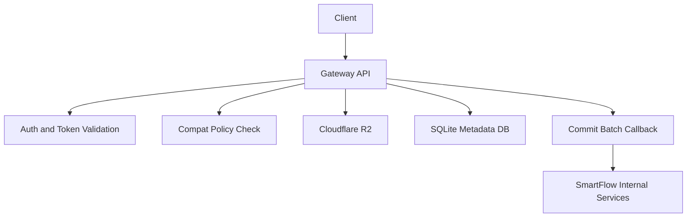

# SmartFlowSocial Blossom

[](https://github.com/xdzczk/smartflowsocial-blossom/actions/workflows/ci.yml)
[](LICENSE)
[](https://nodejs.org/)

[Blossom](https://github.com/hzrd149/blossom) (BUD) media gateway for
[SmartFlowSocial](https://smartflow.social). It authenticates uploads, verifies blob integrity,
stores media in Cloudflare R2, and commits uploads back to SmartFlowSocial.

Part of SmartFlowSocial. Related pieces: [app](https://github.com/xdzczk/smartflowsocial),
[publisher](https://github.com/xdzczk/smartflowsocial-publisher),
[Blastr](https://github.com/xdzczk/smartflowsocial-blastr),
[cache worker](https://github.com/xdzczk/smartflowsocial-cache-worker).

It also supports a compatibility lane for Blossom clients that do not yet provide SmartFlow upload
tokens.

## Contents

- [Why this exists](#why-this-exists)
- [Architecture at a glance](#architecture-at-a-glance)
- [Quick start](#quick-start)
- [Configuration](#configuration)
- [API](#api)
- [Security model](#security-model)
- [Deployment notes](#deployment-notes)

## Why This Exists

- Provide a lightweight, dedicated media ingestion service.
- Enforce security and subscription policy at upload time.
- Keep blob storage in R2 while maintaining reliable internal commit semantics.
- Offer compatibility for existing Blossom ecosystem clients.

## Core Capabilities

- Dual upload lanes:
  - **Authoritative lane** via `X-SFS-Upload-Token`
  - **Compatibility lane** via Blossom auth only (policy-gated)
- Streamed upload with SHA-256 verification and MIME enforcement.
- Replay protection using token JTI persistence.
- Retryable commit reconciliation for upstream callback failures.
- Health/readiness endpoints and Prometheus-style metrics output.

## Architecture at a Glance



## Requirements

- Node.js `>=20`
- `pnpm` (project uses `pnpm@10.27.0`)
- Cloudflare R2 bucket + credentials
- Optional SmartFlow internal endpoints (commit/policy) for full authoritative behavior

## Quick Start

```bash
pnpm install
cp .env.example .env
# edit .env
pnpm build
pnpm start
```

Service defaults to port `5050`. `docker compose up` starts the gateway with MinIO for local object
storage. Copy `.env.example` when you run the process directly. The compose file already sets the
variables the process requires.

## Local Development

```bash
pnpm dev
```

Validation and test commands:

```bash
pnpm validate
pnpm test
pnpm test:coverage
pnpm test:unit
pnpm test:integration
pnpm test:security
pnpm test:property
pnpm test:performance
```

## Configuration

### Required Variables

| Variable                  | Description                                                                      |
| ------------------------- | -------------------------------------------------------------------------------- |
| `DB_PATH`                 | Directory containing the SQLite DB file.                                         |
| `R2_BUCKET`               | R2 bucket name.                                                                  |
| `R2_ENDPOINT`             | R2 API endpoint (for example `https://<account>.r2.cloudflarestorage.com`).      |
| `R2_ACCESS_KEY_ID`        | R2 access key ID.                                                                |
| `R2_SECRET_ACCESS_KEY`    | R2 secret access key.                                                            |
| `SFS_UPLOAD_TOKEN_SECRET` | HMAC secret for upload token verification. Must not match `SFS_INTERNAL_SECRET`. |

### Important Optional Variables

| Variable                                | Default                            | Description                                         |
| --------------------------------------- | ---------------------------------- | --------------------------------------------------- |
| `PORT`                                  | `5050`                             | HTTP listen port.                                   |
| `AUTH_TOLERANCE_SECONDS`                | `60`                               | Allowed auth clock skew in seconds.                 |
| `HOST`                                  | `0.0.0.0`                          | Listen address.                                     |
| `TRUST_PROXY`                           | off                                | `true`, `false`, a hop count, or a proxy address.   |
| `CORS_ALLOWED_ORIGINS`                  | empty                              | Comma-separated browser origins.                    |
| `SFS_COMMIT_BATCH_SIZE`                 | `20`                               | Commits per reconciliation batch.                   |
| `SFS_COMMIT_FLUSH_MS`                   | `2000`                             | Flush delay for the commit buffer, in milliseconds. |
| `SFS_COMPAT_DAILY_BYTES_LIMIT`          | `524288000`                        | Daily byte cap for the compatibility lane.          |
| `BLOSSOM_PUBLIC_URL`                    | `https://blossom.smartflow.social` | Base URL returned in upload responses.              |
| `SFS_INTERNAL_URL`                      | empty                              | Base URL for internal SmartFlow callbacks.          |
| `SFS_INTERNAL_SECRET`                   | empty                              | Shared secret for internal endpoints.               |
| `SFS_COMMIT_BATCH_URL`                  | derived                            | Commit callback endpoint.                           |
| `SFS_COMMIT_MAX_ATTEMPTS`               | `10`                               | Max retries before dead-lettering failed commits.   |
| `SFS_POLICY_URL`                        | derived                            | Compatibility policy endpoint.                      |
| `SFS_POLICY_CACHE_TTL_SEC`              | `90`                               | Compat policy cache TTL seconds.                    |
| `SFS_COMPAT_MODE_ENABLED`               | `true`                             | Enable compatibility upload lane.                   |
| `SFS_COMPAT_MAX_UPLOAD_BYTES`           | `52428800`                         | Max bytes for compat lane (50MB default).           |
| `SFS_READINESS_MAX_PENDING_COMMITS`     | `1000`                             | Readiness threshold for retryable commit backlog.   |
| `SFS_READINESS_MAX_DEAD_LETTER_COMMITS` | `0`                                | Readiness threshold for dead-lettered commits.      |
| `RATE_LIMIT_MODE`                       | `local`                            | `local` (in-process) or `redis` (distributed).      |
| `RATE_LIMIT_REDIS_URL`                  | empty                              | Redis URL used when `RATE_LIMIT_MODE=redis`.        |
| `RATE_LIMIT_REDIS_KEY_PREFIX`           | `sfs:rl`                           | Prefix for Redis rate-limit keys.                   |
| `RATE_LIMIT_*`                          | varies                             | Upload/IP/byte token-bucket limits.                 |
| `METRICS_TOKEN`                         | empty                              | Token gate for `/metrics` access.                   |
| `METRICS_ALLOWLIST`                     | empty                              | Comma-separated IP allowlist for `/metrics`.        |
| `NATIVE_BINDINGS_PATH`                  | empty                              | Optional path to better-sqlite3 native bindings.    |

See `.env.example` for the full list.

## API

### `PUT /upload`

Upload endpoint with two modes:

- **Authoritative lane**
  - Requires `X-SFS-Upload-Token`
  - Optionally accepts Blossom auth header (must match token subject if present)
  - Validates hash/size/type expectations from token context
  - Persists blob metadata and enqueues authoritative commit

- **Compatibility lane**
  - No upload token header
  - Requires valid Blossom auth
  - Policy-gated via internal policy endpoint
  - Uses stricter size/rate controls
  - Stores compat metadata only

Response includes:

- `url`
- `sha256`
- `size`
- `type`
- compatibility keys `x` and `m`

### `HEAD /:key`

Returns object metadata if present:

- `200` with `Content-Type` and `Content-Length`
- `404` if missing

### `DELETE /:key`

- Requires Blossom auth with `t=delete`
- Delete allowed only for object owner pubkey
- Returns `204`

### `DELETE /internal/blob/:key`

- Internal/admin delete path
- Requires `x-internal-secret`
- Returns success payload

### Operational Endpoints

- `GET /health` - liveness
- `GET /ready` - dependency-aware readiness (DB, storage, policy status, backlog)
- `GET /metrics` - Prometheus-style metrics; open by default only in dev/test when no
  token/allowlist is configured

## Security Model

- Upload token and internal secret are explicitly separated.
- JTI replay protection is persisted in SQLite.
- Integrity validation includes streamed SHA-256 checks.
- MIME validation restricts uploads to image/video classes.
- Metrics endpoint is deny-by-default in production unless `METRICS_TOKEN` or `METRICS_ALLOWLIST` is
  set.

More:

- [SECURITY.md](SECURITY.md)
- [Threat model](docs/security/threat-model.md)
- [Operational security checklist](docs/security/operational-security-checklist.md)

## Reliability and Operations

- Commit callbacks are retried via durable reconciliation queue.
- Commits that exceed retry attempts move to dead-letter state for operator action.
- Graceful shutdown flushes commit state before exit (with timeout guard).
- Readiness reflects operational dependency health, not process liveness only.
- Reconciliation commit payloads are chunked by `SFS_COMMIT_BATCH_SIZE` per `batchId`.

## Deployment Notes

- `RATE_LIMIT_MODE=local` uses in-memory token buckets and is per-instance.
- If running multiple gateway instances, use upstream global throttling (WAF/LB/API gateway) for
  hard limits.
- `RATE_LIMIT_MODE=redis` requires `RATE_LIMIT_REDIS_URL`; startup fails fast if missing or
  unreachable.

## Active runtime surface

Production build path is `src/index.ts` to `src/server.ts` to `build/index.js`. Change the gateway
under `src/` and `tests/`.

Runbooks and SLOs:

- [SLO index](docs/slo-and-ops.md)
- [SLOs](docs/ops/slos.md)
- [Runbook](docs/ops/runbook.md)
- [Backup and recovery](docs/ops/backup-recovery.md)

## CI/CD and Quality Gates

Repository includes workflows for:

- CI quality gates
- PR checks
- coverage reporting
- matrix testing
- flaky test detection
- release security checks
- container image build/publish

Each PR is expected to pass lint, typecheck, tests, and coverage constraints.

## Contributing

See:

- [CONTRIBUTING.md](CONTRIBUTING.md)
- [Developer guide](docs/development/developer-guide.md)
- [Boundaries](docs/architecture/boundaries.md)
- [Style guide](docs/meta/style-guide.md)
- [Documentation index](docs/README.md)

## License

Released into the public domain under the [Unlicense](LICENSE). This project follows the
[Code of Conduct](CODE_OF_CONDUCT.md). Report security issues through [SECURITY.md](SECURITY.md).
